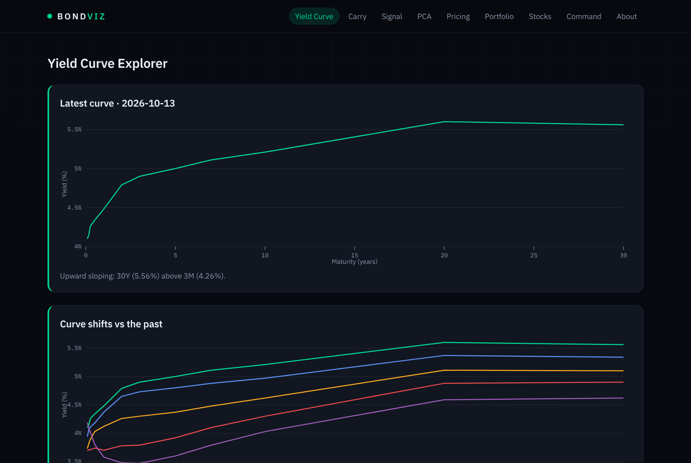
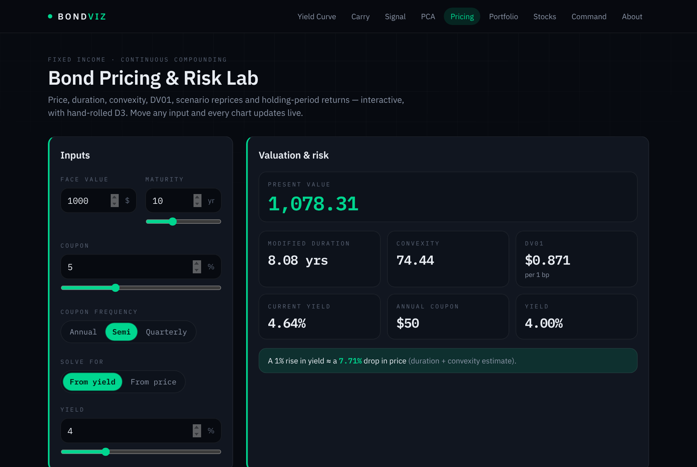
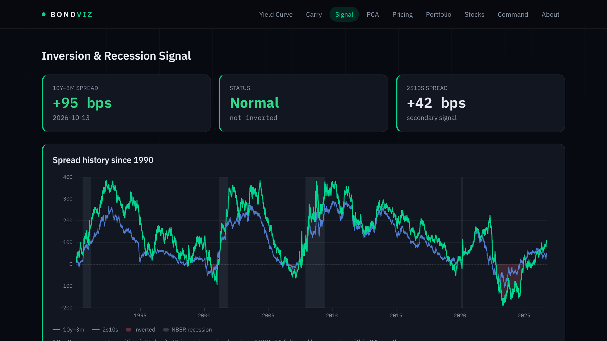
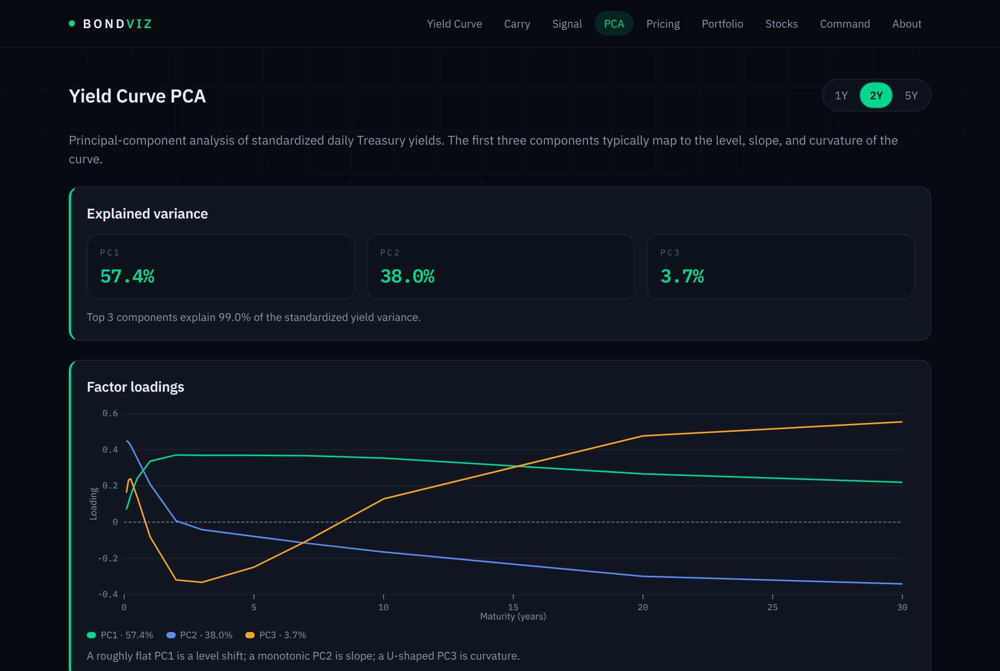
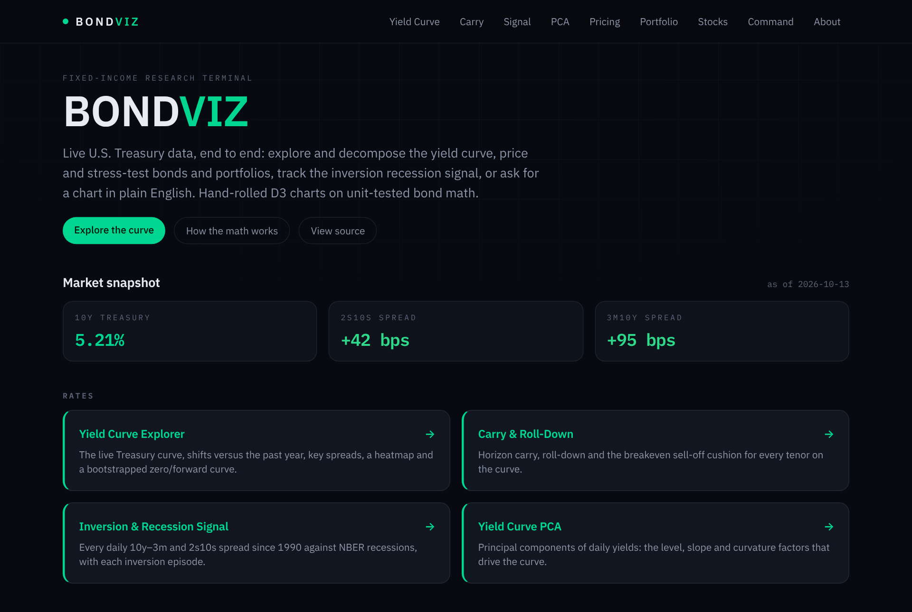
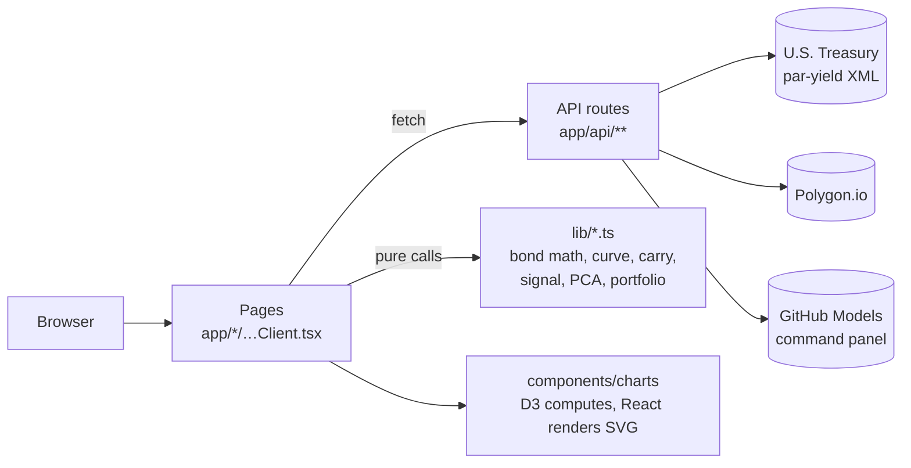

# BondViz

**A fixed-income research terminal on live U.S. Treasury data.** Explore and decompose the yield
curve, price and stress-test bonds and portfolios, track the inversion recession signal, or ask
for a chart in plain English. Hand-rolled D3 charts on unit-tested bond math.

**Live: [bondviz.nikolayvalev.com](https://bondviz.nikolayvalev.com)** ·
[Methodology](https://bondviz.nikolayvalev.com/about) ·
[Design system](https://bondviz.nikolayvalev.com/styleguide)

[](https://github.com/NikolayValev/bondviz/actions/workflows/ci.yml)



## What's inside

| Tool | What it does |
| --- | --- |
| [**Yield Curve Explorer**](https://bondviz.nikolayvalev.com/yield-curve) | The live par curve, shifts versus the past year, 2s10s / 3m10y history, a date × tenor heatmap, and a bootstrapped zero and 6-month forward curve. |
| [**Carry & Roll-Down**](https://bondviz.nikolayvalev.com/carry) | Horizon carry, roll-down and the breakeven sell-off cushion for every tenor. |
| [**Inversion & Recession Signal**](https://bondviz.nikolayvalev.com/signal) | Every daily 10y–3m and 2s10s spread since 1990 against NBER recessions, with each inversion episode. |
| [**Yield Curve PCA**](https://bondviz.nikolayvalev.com/pca) | Level, slope and curvature factors from a from-scratch Jacobi eigensolver. |
| [**Bond Pricing & Risk Lab**](https://bondviz.nikolayvalev.com/pricing) | PV, duration, convexity, DV01, yield-from-price, rate-shock scenarios and holding-period returns. |
| [**Portfolio Analyzer**](https://bondviz.nikolayvalev.com/portfolio) | Value-weighted risk for a book of bonds, stressed with parallel shifts. |
| [**Stocks**](https://bondviz.nikolayvalev.com/stocks) | Daily price history from Polygon.io (the key stays server-side). |
| [**Command Panel**](https://bondviz.nikolayvalev.com/command-panel) | Ask for a chart in plain English; an LLM proposes a widget that can only read from a fixed registry of server-side metrics. |

| | |
| --- | --- |
|  |  |
|  |  |

Every formula, and every convention behind it, is written up on the
**[methodology page](https://bondviz.nikolayvalev.com/about)**. For example, pricing uses
continuous compounding while the curve bootstrap treats par yields as semiannual coupons, and
the two are never mixed.

## How it's built



- **Next.js 16 (App Router) · React 19 · TypeScript (strict) · Tailwind CSS v4.**
- **Math is pure and tested.** Every module in `web/lib/` is a pure function with a Vitest suite
  beside it. External I/O lives only in `app/api/*` routes, which cache and fail soft.
- **No charting library.** D3 computes scales and paths, React owns the SVG, and colors come from
  design tokens shown on [`/styleguide`](https://bondviz.nikolayvalev.com/styleguide).
- **CI** runs tests, ESLint, `tsc` and a production build for the web app, and `pytest` for the
  Python reference, on every push.
- **Fully keyless by default.** Treasury data needs no API key. Polygon and GitHub Models keys are
  optional and only enable the Stocks and Command pages.

More detail: [`docs/ARCHITECTURE.md`](docs/ARCHITECTURE.md) (file map, conventions, how a page is
built) and [`docs/DESIGN-SYSTEM.md`](docs/DESIGN-SYSTEM.md).

## Run it locally

```bash
cd web
npm install
npm run dev        # http://localhost:3000
npm test           # Vitest
npx eslint .       # lint
npm run build      # production build
```

Optional keys go in `web/.env.local` (git-ignored):

```bash
POLYGON_API_KEY=...       # Stocks page
GITHUB_MODELS_TOKEN=...   # Command panel (fine-grained PAT with models:read)
```

Deployment (Vercel, root directory `web/`, custom domain via Cloudflare) is described in
[`web/README.md`](web/README.md).

## Repository layout

```
web/            Next.js app (the product)
docs/           architecture, design system, backlog, bugs, decision logs
src/bondviz/    Python reference implementation (+ optional pybind11 C++ extension)
app/, scripts/  Streamlit app and CLI for the Python version
tests/          pytest suite for the Python version
```

### The Python reference implementation

BondViz started as a Python/Streamlit app. Its pricing core has an optional **pybind11 C++
extension** (`bondviz._native`) that falls back to pure Python when it isn't compiled. The
TypeScript library in `web/lib/` is a port of it, and the Python tests were carried over with the
port. The Python code stays in the repo as the numerical reference and is still tested in CI.

```bash
python -m venv .venv && source .venv/bin/activate     # Windows: .venv\Scripts\activate
pip install -e ".[dev]"                                # builds the C++ extension if a toolchain exists
pytest
streamlit run app/streamlit_app.py                     # http://localhost:8501
```

Windows/Unix helper scripts live in `scripts/win/` and `scripts/unix/`, and
[`CLAUDE.md`](CLAUDE.md) documents the Python architecture.

## License

MIT
